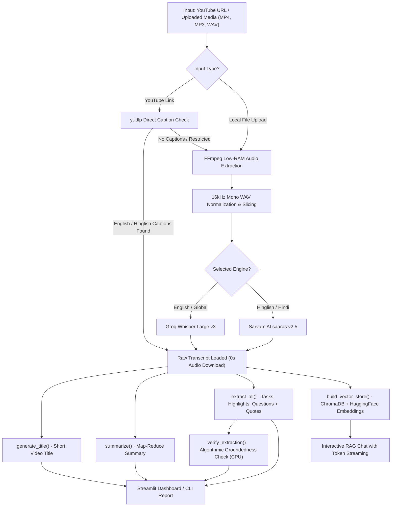

# AI Video Assistant 🎥🤖

<p align="center">
  
</p>

<p align="center">
  <strong>Intelligent Video & Audio Analysis, Multi-Section Summaries, Hallucination-Guarded Evidence Verification, and Interactive RAG Chat.</strong>
</p>

<p align="center">
  <a href="https://www.python.org/downloads/"></a>
  <a href="https://streamlit.io/"></a>
  <a href="https://www.langchain.com/"></a>
  <a href="https://groq.com/"></a>
  <a href="https://www.trychroma.com/"></a>
  <a href="LICENSE"></a>
</p>

---

## 📌 Overview

**AI Video Assistant** is an end-to-end meeting, lecture, and video intelligence platform. It accepts public YouTube links or local video/audio uploads (`.mp4`, `.mp3`, `.wav`, `.m4a`, `.mkv`, etc.), transcribes the spoken content via high-speed models, extracts structured action items and highlights backed by verbatim quotes, fact-checks every claim against the transcript to guard against LLM hallucinations, and provides an interactive RAG chat interface to query the video.

Available both as an interactive **Streamlit Web Dashboard** and a lightweight **Command-Line Interface (CLI)**.

---

## ✨ Key Features

* **⚡ Direct YouTube Transcript Bypass**: Uses mobile player client simulation via `yt-dlp` to directly fetch native captions in seconds, bypassing 403 Forbidden errors, datacenter IP blocks, and cloud API quotas.
* **🌐 Language-Aware Caption Selection**: Strictly matches requested languages (`English` or `Hindi/Hinglish`) and validates character scripts to prevent pulling unintended foreign-language tracks.
* **🎙️ Dual Speech-to-Text Engines**:
  * **Groq Whisper Large v3**: Ultra-fast global speech-to-text with exponential backoff retries.
  * **Sarvam AI (`saaras:v2.5`)**: State-of-the-art Hindi and code-switched Hinglish speech-to-English translation.
* **🛡️ Zero-Cost Groundedness Engine**: Evaluates every extracted action item, highlight, and question against the raw transcript using deterministic N-gram and quote matching on CPU—protecting against hallucinations with **0 extra API calls and 0 latency overhead**.
* **📋 Structured Intelligence**:
  * **Executive Summary**: Map-reduce bulleted summary with chunk grouping that guarantees 100% video coverage.
  * **Action Items Table**: Interactive Pandas table with Tasks, Assignees, Deadlines, Verbatim Evidence Quotes, and Grounding Status.
  * **Highlights & Questions**: Clean blockquotes with quote icons and verification badges (`:material/check_circle: Verified in Video`).
* **💬 Interactive RAG Chat**: Ephemeral in-memory ChromaDB vector store with HuggingFace sentence embeddings (`all-MiniLM-L6-v2`) and LangChain LCEL runnable streaming.
* **📥 One-Click Export**: Download the full raw transcript (`.txt`) or a comprehensive Markdown meeting report (`.md`).
* **🧹 Automatic File Cleanup**: All intermediate downloads, converted 16kHz WAVs, and audio slices run in isolated temporary workspaces and are automatically deleted upon completion.

---

## 🏗️ Pipeline Architecture



---

## 📁 Project Structure

```
AI-Video-Assistant/
├── app.py                   # Streamlit web dashboard & interactive UI
├── main.py                  # CLI pipeline entry point
├── requirements.txt         # Pinned Python dependencies (Python 3.10 - 3.13+)
├── .env                     # Environment configuration & API keys
├── .gitignore               # Git exclusion rules
├── .streamlit/
│   └── config.toml          # Streamlit configuration (500 MB upload limit)
├── assets/
│   ├── favicon.png          # Web browser favicon
│   └── logo.png             # Application brand logo
├── core/
│   ├── transcriber.py       # Groq Whisper and Sarvam AI STT clients
│   ├── summarizer.py        # Map-reduce summarization with ceiling chunk grouping
│   ├── extractor.py         # Multi-section intelligence extraction
│   ├── verifier.py          # Groundedness & verbatim quote validation engine
│   ├── vector_store.py      # In-memory ChromaDB vector store
│   └── rag_engine.py        # LCEL retrieval chain with token streaming
└── utils/
    └── audio_processor.py   # YouTube bypass, FFmpeg streaming, and temp cleanup
```

---

## 💻 Tech Stack

| Layer | Component | Details |
|---|---|---|
| **Frontend** | Streamlit | Responsive dashboard with native Material symbols, tabs, and streaming |
| **Orchestration** | LangChain LCEL | Composable runnables, prompt templates, and streaming output parsers |
| **STT (Global)** | Groq Whisper Large v3 | Cloud speech-to-text with rate-limit backoff |
| **STT (Indic)** | Sarvam AI (`saaras:v2.5`) | Spoken Hindi & code-switched Hinglish to English translation |
| **LLM Inference** | Groq Cloud (`openai/gpt-oss-120b`) | Primary high-throughput inference engine |
| **Fallback LLM** | Mistral AI (`mistral-small-latest`) | Automatic fallback if no Groq key is present |
| **Fact-Checking** | Custom Verifier (`core.verifier`) | Deterministic N-gram and normalized quote overlap on CPU |
| **Vector Index** | ChromaDB | Ephemeral in-memory collection per session |
| **Embeddings** | HuggingFace (`all-MiniLM-L6-v2`) | Local CPU sentence embeddings |
| **Audio Pipeline** | `yt-dlp`, FFmpeg, `pydub` | Low-RAM stream conversion and audio chunking |

---

## ⚙️ Prerequisites

1. **Python**: Version `3.10` or higher (fully compatible with Python `3.11`, `3.12`, and `3.13` via `audioop-lts`).
2. **FFmpeg**: Required on your system `PATH` for audio normalization and chunking:
   * **Windows**: `winget install Gyan.FFmpeg` or `choco install ffmpeg`
   * **macOS**: `brew install ffmpeg`
   * **Linux**: `sudo apt update && sudo apt install ffmpeg`

Verify installation:
```bash
ffmpeg -version
```

---

## 🚀 Quick Start

### 1. Clone Repository
```bash
git clone https://github.com/Sahil26singh/AI-Video-Assistant.git
cd AI-Video-Assistant
```

### 2. Set Up Virtual Environment
```bash
# Windows (PowerShell)
python -m venv .venv
.\.venv\Scripts\Activate.ps1

# Linux / macOS
python3 -m venv .venv
source .venv/bin/activate
```

### 3. Install Dependencies
```bash
pip install -r requirements.txt
```

### 4. Configure Environment Variables
Create a `.env` file in the project root:
```env
# Primary LLM & Global STT (Get key: https://console.groq.com/keys)
GROQ_API_KEY=gsk_your_groq_api_key

# Optional: Hindi/Hinglish STT (Get key: https://www.sarvam.ai/)
SARVAM_API_KEY=sk_your_sarvam_api_key

# Optional: Alternative LLM fallback (Get key: https://console.mistral.ai/)
MISTRAL_API_KEY=your_mistral_api_key
```

---

## 🖥️ Usage

### Web Dashboard (Streamlit)

Launch the web app:
```bash
streamlit run app.py
```
1. Open `http://localhost:8501` in your browser.
2. Select **YouTube URL** or **Upload File** in the sidebar.
3. Choose the transcription engine (**English / Global** or **Hinglish / Hindi**).
4. Click **Run analysis**.
5. Explore the structured tabs:
   * **Summary**: Executive overview in bullet points.
   * **Action items**: Assignees, deadlines, and verbatim quote attribution.
   * **Highlights**: Key takeaways cross-referenced with exact video evidence.
   * **Questions & follow-ups**: Unresolved questions and issues raised.
   * **Transcript & export**: Full transcript viewer, `.txt` download, and formatted `.md` report download.
6. Use the **Interactive Chat** box below to ask any custom question with real-time response streaming.

### Command-Line Interface (CLI)

Run directly in your terminal:
```bash
python main.py
```
* Enter the YouTube URL or local file path when prompted.
* View terminal summaries, action items, highlights, and grounding statistics.
* Enter interactive terminal Q&A mode to query the video transcript.

---

## 🛡️ Groundedness & Hallucination Guard

Large Language Models frequently hallucinate details when summarizing long recordings. **AI Video Assistant** enforces a multi-layer verification system:

1. **Structured Evidence Generation**: The extraction prompt forces the model to cite exact verbatim quotes for every single task, takeaway, and question.
2. **Deterministic String & N-gram Matching**: `core/verifier.py` normalizes quotes (stripping ASCII and Unicode punctuation such as smart quotes and em-dashes) and executes multi-word contiguous sequence matching against the original transcript.
3. **Attribution Score**: The UI calculates a 0–100% Groundedness score and visually tags every item as `:material/check_circle: Verified in Video` or `:material/help: Unverified`.

---

## 📄 License

This project is open-source and licensed under the [MIT License](LICENSE).
